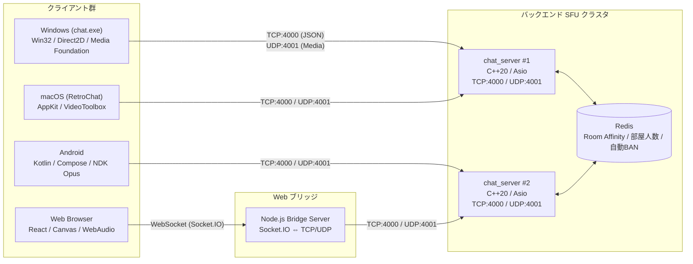

# chat.exe

**あの頃の UI で繋がる、超軽量・超低遅延のネイティブ音声＆ビデオチャット**

[](LICENSE.TXT)
[](#リポジトリ構成)

- **公式配布サイト**: https://chatexe.net/
- **Microsoft Store**: `ms-windows-store://pdp/?productid=9MVJZSR56JJK`
- **Web ブラウザ版**: https://app.chatexe.net/

---

## 概要

**`chat.exe`** は、Windows 95 / 98 / Classic 時代を彷彿とさせるノスタルジックで質実剛健な UI と、現代のハードウェアアクセラレーション・リアルタイム通信技術を融合させたオープンソースのチャットアプリケーション群です。

一般的なモダン通話アプリが巨大なブラウザエンジン（Electron 等）や複雑な WebRTC スタックを抱えて数百 MB のメモリを消費するのに対し、本プロジェクトの Windows クライアントは **純粋な C++17 と Win32 / DirectX ネイティブ API のみで構築された単一実行ファイル（約 1.1 MB）** として動作します。アカウント登録やログインも不要で、起動した瞬間にテキストチャット・音声通話・ビデオ配信・画面共有を始められます。

さらに、同一の軽量プロトコル上で相互接続できる **C++ 製ステートレス SFU サーバー**、**macOS ネイティブ版**、**Android ネイティブ版**、**Web ブラウザ版** を本リポジトリに同梱しています。

---

## 主な特徴・機能

### 1. 極限まで無駄を削ぎ落としたネイティブ設計
- **超軽量・高速起動**: フレームワークやランタイムへの依存を排し、古い PC やゲーム・作業の裏でも CPU / メモリ負荷を最小限に抑えて軽快に動作します。
- **Direct2D / DirectWrite ハードウェア描画**: チャットログ・UI コンポーネント・映像プレビューを GPU アクセラレーションで高速レンダリングします。
- **クラシック UI の忠実な再現**: OS 標準の角丸やドロップシャドウをサブクラス化・オーナードローにより排除し、立体ベベル（3D エッジ）を手動描画。動的 DPI スケーリングやマルチモニター対応のウィンドウスナップ（画面端吸着）も備えています。

### 2. テキストチャット・リッチ装飾
- **テキスト装飾**: 太字（`Ctrl+B`）・斜体（`Ctrl+I`）・下線（`Ctrl+U`）・文字色・フォントサイズのリアルタイム変更に対応。
- **快適な入力体験**: チャット入力欄の元に戻す（`Ctrl+Z`）/ やり直し（`Ctrl+Y`, `Ctrl+Shift+Z`）、複数行入力（`Ctrl+Enter`）、URL の自動リンク化、非アクティブ時のタスクバー点滅通知を搭載。

### 3. 高音質・低遅延ボイスチャット & PC 音源配信
- **Opus 音声圧縮**: `OPUS_APPLICATION_VOIP` モード（16kHz / モノラル / 32kbps）により、極小の通信帯域でクリアな音声通話を実現。
- **ソフトクリッパー内蔵ミキサー**: クライアント側の独自音声ミキサースレッドにソフトクリッピング処理を実装し、多人数が同時に発話しても音割れを防止します。
- **入力ソース切り替え・PC 音源共有**: 複数マイクの選択に加え、**WASAPI ループバックによる PC 内部音声（BGM やシステム音）の直接配信** に対応しています。

### 4. GPU ゼロコピー映像配信 & 画面共有
- **VRAM 完結のゼロコピー H.264 エンコード**: Media Foundation と Direct3D 11 (`MFT_MESSAGE_SET_D3D_MANAGER`) を連携させ、キャプチャから色空間変換・H.264 ハードウェアエンコードまでをシステムメモリへのコピーなし（GPU メモリ上のみ）で完結。ハードウェア非対応環境では自動的にソフトウェアエンコーダへフォールバックします。
- **モダン画面共有 (`Windows.Graphics.Capture`)**: ディスプレイ全体だけでなく、特定のアプリケーションウィンドウ単体を指定した高速・低負荷な画面共有が可能です（複数 Web カメラの切り替えにも対応）。
- **前方誤り訂正 (FEC) と選択的配信**: 映像パケットに対する XOR ベースの FEC パケット生成・復元機能により、パケットロス発生時の映像破綻を抑制。また、サーバーは「その配信者の映像を視聴中（Subscribe）のユーザー」にのみ映像・FEC パケットを転送するため、帯域を無駄に消費しません。

### 5. ルーム管理・自律モデレーション・多言語対応
- **公開ルーム / 非公開ルーム**: ロビーや自由な公開部屋の作成・移動（最大 32 文字制限・満室時の自動オーバーフロールーム分岐）に加え、部屋一覧に表示されない非公開ルームにも対応。
- **アカウント不要の匿名識別 & 自動 BAN 機構**: クライアントの `secretId` から SHA-256 で一意な匿名 ID を生成。サーバーに会話ログを永続保存しないプライバシー設計を維持しつつ、Redis 上で「異なる 7 ユーザー ID かつ異なる 7 IP アドレス」からの通報が揃った場合のみ 24 時間 BAN を自動発動します（通報スパムへのカウンター BAN 機能付き）。
- **ローカル自衛フィルタ**: 正規表現による多段階 NG ワードフィルタおよび連投スパム検知による自動無視（ミュート）リスト機能をクライアント側に内蔵。
- **19 言語ネイティブ対応**: OS ロケールを自動判定し、日本語・英語・中国語（簡体/繁体）・韓国語・フランス語・ドイツ語・スペイン語・ポルトガル語・ロシア語・アラビア語・ヒンディー語・ベンガル語・インドネシア語・イタリア語・トルコ語・ベトナム語・タイ語・ポーランド語の UI 表示に対応しています。

---

## システムアーキテクチャ

シグナリング（入退室・テキスト・状態通知）には **TCP (Port 4000)**、音声・映像のリアルタイムストリームには独自バイナリヘッダを用いた **UDP (Port 4001)** を使用します。複数台の SFU サーバーを運用する場合でも、Redis を介した **Room Affinity（ルーム単位の担当サーバー割り当てと自動リダイレクト）** により水平スケールアウトが可能です。



### 通信プロトコル概要
- **TCP シグナリング (`Port 4000`)**: 改行 (`\n`) 区切りの UTF-8 JSON メッセージ（`welcome`, `join`, `redirect`, `chat`, `rename`, `room_list`, `video_state`, `report` 等）。`TCP_NODELAY` 有効化により低遅延化。
- **UDP メディアストリーム (`Port 4001`)**: 先頭 12 バイトの固定長ヘッダ `MediaHeader`（`sessionId`, `seqNum`, `payloadType`, `flags`, `timestamp`）に続けてペイロードを格納し、サーバー側ではデコードや再エンコードを一切行わずゼロコピーでルーム内へ中継します。
  - 主な `payloadType`: 音声（Opus）、映像（JPEG / H.264 分割フレーム）、映像視聴キープアライブ（Subscribe 通知）、映像 FEC パケット、NAT キープアライブ。

より詳しい内部設計については [`system_specifications.md`](system_specifications.md) もあわせてご参照ください。

---

## リポジトリ構成

```text
.
├── Source.cpp              # Windows クライアント本体（UI・通信・音声ミキサー・画面制御）
├── H264Helper.h / .cpp     # Media Foundation + D3D11 による GPU ゼロコピー H.264 エンコーダ/デコーダ
├── WgcCaptureSession.h     # Windows.Graphics.Capture API を用いた画面・ウィンドウキャプチャ
├── app.rc / resource.h     # アイコン・ダイアログ・19言語 StringTable・バージョンリソース定義
├── json11.hpp / .cpp       # 軽量 JSON パーサー/シリアライザ
├── chat.sln / chat.vcxproj # Visual Studio ソリューション / プロジェクト定義
├── build_opus.bat          # Windows 向け同梱 Opus 静的ライブラリビルドスクリプト
├── build.bat               # コマンドラインからの chat.exe 高速ビルドスクリプト
├── opus/                   # 同梱 libopus ソースコード一式
├── package/                # Microsoft Store 配布用 MSIX パッケージプロジェクト (.wapproj)
├── chat_server/            # C++20 / Asio / redis++ 製 ステートレス SFU 中継サーバー & Dockerfile
├── chatwebapp/             # Web ブラウザ版クライアント (React/Vite) & Socket.IO ブリッジサーバー
├── mac_chat/               # macOS ネイティブクライアント (Objective-C++ / AppKit / VideoToolbox)
├── android_chat/           # Android ネイティブクライアント (Kotlin / Jetpack Compose / JNI Opus)
├── website/                # 公式紹介ページ用静的 HTML / CSS アセット
├── tools/                  # ストア申請自動化・Redis ルーム集計などの運用補助スクリプト
└── system_specifications.md # アーキテクチャ・フェイルセーフ・モデレーション詳細仕様書
```

---

## ビルド方法

### 1. Windows クライアント (`chat.exe`)

#### 必要な環境
- **OS**: Windows 10 / 11 (64bit)
- **開発ツール**: Visual Studio 2022 または 2026（「**C++ によるデスクトップ開発**」ワークロード、MSVC v143 / v145、Windows 10/11 SDK）
- **CMake**: 3.20 以上（Visual Studio 同梱の CMake で可）

#### 手順 A: Visual Studio 開発者コマンドプロンプトからビルドする（推奨）
**x64 Native Tools Command Prompt for VS** を開き、リポジトリルートで以下を実行します。

```bat
:: 1. 同梱されている Opus 静的ライブラリ (opus/build/opus.lib) を初回のみビルド
cmake -S opus -B opus/build -G "NMake Makefiles" -DCMAKE_BUILD_TYPE=Release
cmake --build opus/build

:: 2. リソースのコンパイルと chat.exe のビルド
rc.exe /fo app.res app.rc
cl.exe /EHsc /MD /O2 /Zm200 /D UNICODE /D _UNICODE /utf-8 /std:c++17 ^
  /I opus\include Source.cpp json11.cpp H264Helper.cpp app.res ^
  /link opus\build\opus.lib User32.lib Gdi32.lib Ole32.lib OleAut32.lib ws2_32.lib ^
  d2d1.lib dwrite.lib winmm.lib Advapi32.lib Comdlg32.lib mfplat.lib mf.lib mfuuid.lib ^
  wmcodecdspuuid.lib Mfreadwrite.lib d3d11.lib windowsapp.lib version.lib dwmapi.lib ^
  /OUT:chat.exe
```

> **補足**: `build_opus.bat` および `build.bat` を使用する場合は、お使いの Visual Studio のエディション・インストール先に合わせてバッチ先頭の `vcvars64.bat` のパスおよび作業パスを適宜調整してください。

#### 手順 B: Visual Studio IDE / MSBuild でビルドする
1. 上記手順の「1. Opus 静的ライブラリのビルド」を実行し、`opus\build\opus.lib` を生成しておきます。
2. `chat.sln` を Visual Studio で開き、構成を **`Release | x64`** に設定してビルドします（または開発者コマンドプロンプトで以下を実行します）。

```bat
msbuild chat.vcxproj /p:Configuration=Release /p:Platform=x64
```

MSIX パッケージ（`.appxbundle`）ごとビルドする場合は、`package\package.wapproj` を含めて以下のように実行できます（インストール済みの Windows SDK バージョンに合わせて `TargetPlatformVersion` を指定してください）。

```bat
msbuild chat.sln /p:Configuration=Release /p:Platform=x64 /p:AppxBundle=Always /p:UapAppxPackageBuildMode=SideloadOnly
```

---

### 2. C++ SFU サーバー (`chat_server`)

`chat_server` の動作には **Redis サーバー** が必要です。複数台構成だけでなく、ローカルの単一サーバー構成でも簡単に起動できます。

#### 方法 A: Docker でビルド・起動する（推奨）
マルチステージビルド対応の [`chat_server/Dockerfile`](chat_server/Dockerfile) が用意されているため、依存ライブラリの導入を含めてコンテナ内で完結します。

```bash
# 1. Redis コンテナの起動（ローカル検証用の例）
docker run -d --name chat-redis -p 6379:6379 redis:alpine

# 2. chat_server イメージのビルド
docker build -t chat-server ./chat_server

# 3. サーバーの起動 (TCP: 4000 = シグナリング, UDP: 4001 = メディア)
docker run -d --name chat-sfu \
  -p 4000:4000/tcp \
  -p 4001:4001/udp \
  -e ENDPOINT="127.0.0.1:4000" \
  -e REDIS_URL="tcp://127.0.0.1:6379" \
  chat-server
```

> Linux ホスト上で高負荷運用する場合は `--net host` の使用を推奨します。また、パスワード付き Redis を使用する場合は `REDIS_URL="tcp://default:<PASSWORD>@<HOST>:6379"` の形式で指定します。

#### 方法 B: Ubuntu / Debian Linux 上でネイティブビルドする

```bash
# 1. 依存パッケージのインストール
sudo apt-get update
sudo apt-get install -y build-essential cmake git libasio-dev libhiredis-dev libssl-dev

# 2. redis-plus-plus のビルドとインストール
git clone https://github.com/sewenew/redis-plus-plus.git
cmake -S redis-plus-plus -B redis-plus-plus/build -DREDIS_PLUS_PLUS_CXX_STANDARD=17 -DCMAKE_BUILD_TYPE=Release
cmake --build redis-plus-plus/build -j
sudo cmake --install redis-plus-plus/build
sudo ldconfig
rm -rf redis-plus-plus

# 3. chat_server のビルド
cmake -S chat_server -B chat_server/build -DCMAKE_BUILD_TYPE=Release
cmake --build chat_server/build --config Release

# 4. 起動（環境変数またはコマンドライン引数で ENDPOINT と REDIS_URL を指定可能）
ENDPOINT="127.0.0.1:4000" REDIS_URL="tcp://127.0.0.1:6379" ./chat_server/build/chat_server
```

#### 方法 C: Windows 上でビルドする (`vcpkg` 使用)
`vcpkg` で `asio:x64-windows` と `redis-plus-plus:x64-windows` をインストールした上で、CMake にツールチェーンファイルを指定してビルドします。

```powershell
cmake -S chat_server -B chat_server/build -DCMAKE_TOOLCHAIN_FILE="$env:VCPKG_ROOT/scripts/buildsystems/vcpkg.cmake"
cmake --build chat_server/build --config Release
```

---

### 3. Web ブラウザ版 (`chatwebapp`)

Web 版は **React + TypeScript + Vite 製のフロントエンド** と、ブラウザからの WebSocket (Socket.IO) 通信をバックエンド SFU サーバーの TCP/UDP プロトコルへ変換する **Node.js ブリッジサーバー** で構成されています。

#### 必要な環境
- **Node.js**: v20 以上 / npm

#### フロントエンドの起動・ビルド
```bash
cd chatwebapp
npm install

# 開発サーバー起動 (HMR)
npm run dev

# 本番用静的ファイルのビルド (chatwebapp/dist に出力)
npm run build
```

#### WebSocket ⇔ TCP/UDP ブリッジサーバーの起動
```bash
cd chatwebapp/server
npm install

# TypeScript をコンパイルする場合
npx tsc

# ブリッジサーバーの起動
node index.js
```

---

### 4. macOS クライアント (`mac_chat`)

AppKit・AVFoundation・VideoToolbox・AudioToolbox・CoreAudio を用いた macOS ネイティブ実装（`RetroChat.app`）です。

#### 必要な環境
- **OS**: macOS 10.13 以降
- **開発ツール**: Xcode Command Line Tools (`clang++`)、CMake 3.14 以上

```bash
cd mac_chat
cmake -S . -B build -DCMAKE_BUILD_TYPE=Release
cmake --build build --config Release

# 生成されたアプリケーションバンドルの起動
open build/RetroChat.app
```

---

### 5. Android クライアント (`android_chat`)

Kotlin / Jetpack Compose による UI と、CMake + Android NDK によるネイティブ Opus ラッパー (`opus_wrapper`) を組み合わせた Android クライアントです（リポジトリルートの `opus/` ディレクトリを直接参照してネイティブビルドを行います）。

#### 必要な環境
- **Android Studio**（JDK 17、Android SDK 34、NDK、CMake 3.22.1 以上）

```bash
cd android_chat

# macOS / Linux
./gradlew assembleDebug

# Windows (PowerShell / コマンドプロンプト)
.\gradlew.bat assembleDebug
```
ビルド完了後、`android_chat/app/build/outputs/apk/debug/app-debug.apk` に APK が出力されます。

---

## キーボードショートカット（Windows クライアント）

| ショートカット | 動作 |
| :--- | :--- |
| `Enter` | メッセージを送信 |
| `Ctrl + Enter` | 入力欄で改行を挿入 |
| `Ctrl + B` | 太字（Bold）の切り替え |
| `Ctrl + I` | 斜体（Italic）の切り替え |
| `Ctrl + U` | 下線（Underline）の切り替え |
| `Ctrl + Z` | チャット入力欄の操作を元に戻す（Undo） |
| `Ctrl + Y` / `Ctrl + Shift + Z` | チャット入力欄の操作をやり直す（Redo） |
| `Ctrl + R` | 部屋移動ダイアログを開く |
| `Ctrl + C` / `Ctrl + X` / `Ctrl + V` | コピー / 切り取り / 貼り付け（ログ領域での選択コピーにも対応） |
| `Ctrl + A` | 入力テキストをすべて選択 |

---

## ライセンス

本プロジェクトは [MIT License](LICENSE.TXT) の下で公開されています。  
同梱されている `opus/` ディレクトリ内の libopus ソースコードについては、[`opus/COPYING`](opus/COPYING) に記載された BSD ライセンスに従います。
